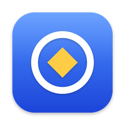
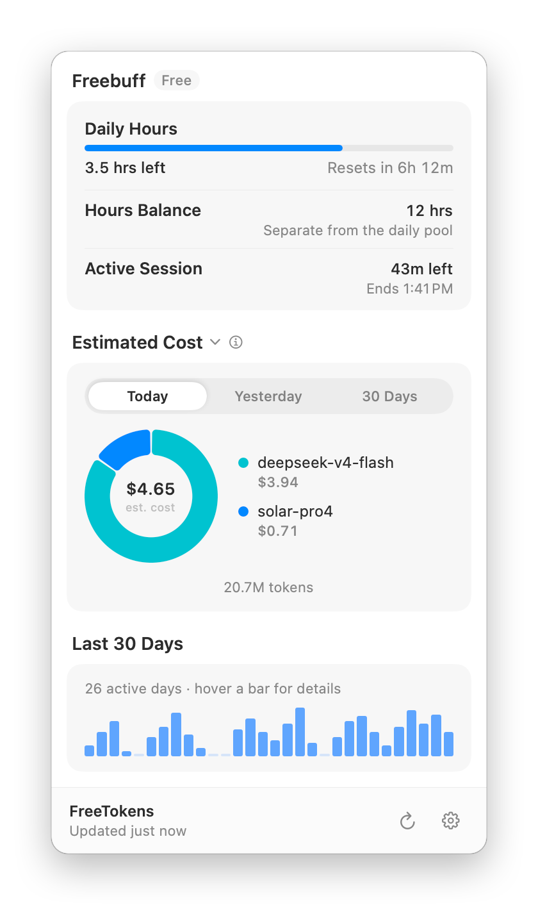
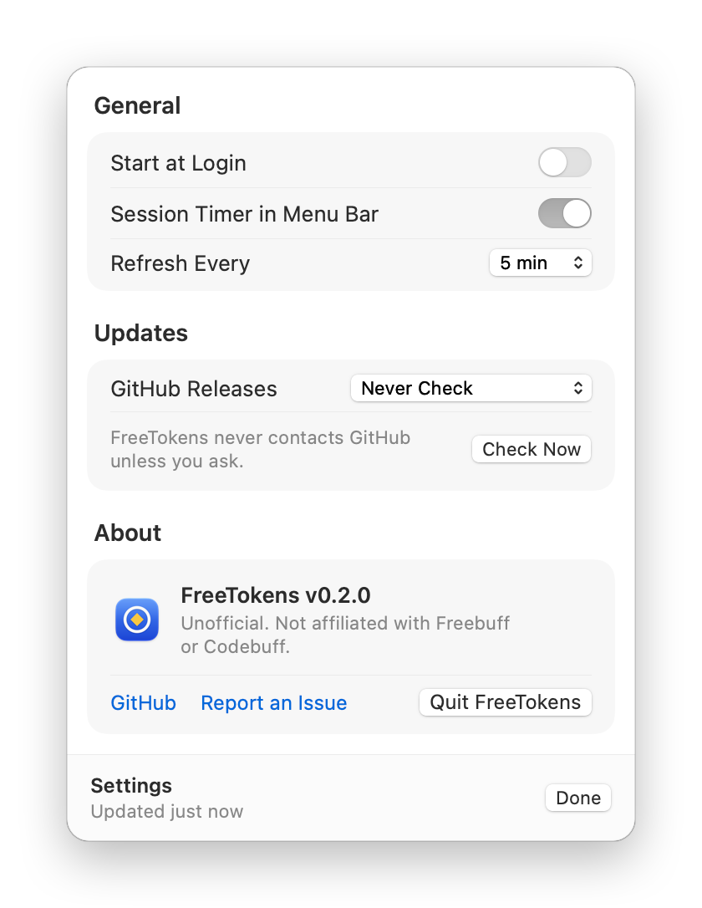

<p align="center">
  
</p>

<h1 align="center">FreeTokens</h1>

<p align="center">
  Your Freebuff hours, session timers and token usage in the menu bar, the system tray and the terminal.
</p>

<p align="center">
  <a href="https://github.com/tverma101/FreeTokens/releases/latest"></a>
  <a href="https://github.com/tverma101/FreeTokens/actions/workflows/ci.yml"></a>
  
  <a href="LICENSE"></a>
</p>

<p align="center">
  <picture>
    <source media="(prefers-color-scheme: dark)" srcset="docs/images/macos-panel-dark.png">
    
  </picture>
  
</p>

FreeTokens shows your Freebuff hours, session timers and measured token usage, with estimated
dollar costs at public API rates. On macOS it's a native menu bar app; on Windows, Linux and the
BSDs it's a system tray icon; everywhere it's also a command-line tool.

> **Unofficial.** FreeTokens is not affiliated with, endorsed by, or supported by Freebuff,
> Codebuff or CodebuffAI. It only reads your own usage with your existing Freebuff login.

## What it shows

| Row | Source |
| --- | --- |
| **Daily Hours** – hours left in today's free pool and when it resets | Freebuff session endpoint (read-only GET) |
| **Hours Balance** – your separate wallet, in whole hours (5 Freebucks = 1 hour) | same |
| **Monthly Spend** – when Freebuff reports USD | same |
| **Session timers** – time left on each active session, in the menu bar title on macOS and in the tooltip elsewhere | same |
| Legacy **Daily / Weekly / Monthly / 5-Day / Premium** session windows on older accounts | same |
| **Today / Yesterday / Last 30 Days** tokens per model, with estimated cost | Hosted run history plus Freebuff Desktop's local history |

Token counts are measured receipts, never estimates. Dollar figures are **estimates at public API
prices** (the [OpenRouter](https://openrouter.ai/api/v1/models) model list and the OpenUsage
pricing supplement), not what Freebuff charges you. A total marked `≥` is a lower bound: some
tokens belong to a model with no public price, or some runs have no complete receipt yet.

## Install

Everything is on the [Releases](https://github.com/tverma101/FreeTokens/releases/latest) page.
Each release lists SHA-256 sums in `checksums.txt`.

### macOS (menu bar app)

1. Download `FreeTokens-<version>-macOS.zip` (one app for Apple silicon and Intel, macOS 13 or later).
2. Open the zip and drag **FreeTokens.app** into **Applications**.
3. Open FreeTokens. Releases aren't notarized yet, so the first launch is blocked. Go to
   **System Settings → Privacy & Security** and choose **Open Anyway**, or run this once:

   ```bash
   xattr -dr com.apple.quarantine /Applications/FreeTokens.app
   ```

4. Click the FreeTokens icon in the menu bar. Turn on **Settings → Start at Login** to keep it running.

If the menu bar is full, macOS may hide the icon; check **System Settings → Menu Bar**. Opening
FreeTokens again from Finder or Spotlight always shows the panel (at the top right of the screen
when the icon is hidden).
Right-click the icon for **Refresh Now**, **Settings** and **Quit**.

The app includes the command-line tool. To use it from a terminal:

```bash
sudo ln -s /Applications/FreeTokens.app/Contents/Helpers/freetokens /usr/local/bin/freetokens
```

### Windows

Download `freetokens_<version>_windows_amd64.zip` (or `arm64` / `386`) and extract it to a folder
such as `%LOCALAPPDATA%\Programs\FreeTokens`. It holds two copies of the same program:
`freetokens.exe` for the command line, and `freetokensw.exe`, which starts the tray without a
console window. Double-click `freetokensw.exe` to start the tray, then turn on **Settings → Start
with Windows**. Windows may hide new tray icons under the **^** arrow; drag the icon onto the
taskbar to keep it visible. SmartScreen may warn on first launch because releases aren't
code-signed yet; choose **More info → Run anyway**.

### Linux and BSD

Download the archive for your platform, extract `freetokens` somewhere on your `PATH`, and run
`freetokens` from your desktop session to start the tray. The builds are pure Go with no system
libraries, so the CLI also works on servers. The tray needs a desktop with StatusNotifierItem
support: KDE, or GNOME with the AppIndicator extension, Xfce, Cinnamon, and others.

| OS | Architectures |
| --- | --- |
| macOS 13+ app | Universal (Apple silicon and Intel) |
| macOS 12+ CLI | `arm64`, `amd64` |
| Windows 10+ | `amd64`, `arm64`, `386` |
| Linux | `amd64`, `arm64`, `armv6`, `armv7`, `386`, `riscv64`, `ppc64le`, `s390x`, `loong64` |
| FreeBSD | `amd64`, `arm64` |
| OpenBSD | `amd64`, `arm64` |
| NetBSD | `amd64` |

The macOS CLI archives (`freetokens_<version>_darwin_<arch>.tar.gz`) are still published for
terminal-only use. After extracting one, clear the quarantine flag with
`xattr -d com.apple.quarantine ./freetokens`.

### From source

With Go 1.26+:

```bash
go install github.com/tverma101/FreeTokens/cmd/freetokens@latest
```

To build the macOS app (needs Xcode): `scripts/build-macos-app.sh` writes
`dist-app/FreeTokens.app`.

## Use

```bash
freetokens            # tray / menu bar (prints status instead when there is no desktop session)
freetokens status     # one-off report; --json for scripts
freetokens autostart on   # on Windows this registers freetokensw.exe
```

```text
$ freetokens status
Freebuff · free
  Daily Hours: 3.5 h left of 5 h · resets in 6h 12m
  Hours Balance: 12 h
  Session 1: 42m left

Tokens (estimated at public API rates)
  Today: 20.73M tokens · ~$4.65
    deepseek/deepseek-v4-flash: 18.42M · ~$3.94
    upstage/solar-pro4: 2.31M · ~$0.71
  Last 30 Days: 700.55M tokens · ~$155.31
```

The screenshots and sample above use demo data.

You need to have signed in once with the Freebuff CLI (`freebuff login`). FreeTokens reads the
CLI's existing `default` profile and never signs in, starts a session, or changes your account. It
looks for the token in these places, in order:

1. `authToken` in `~/.config/manicode/credentials.json`, or in `$FREEBUFF_CONFIG_DIR/credentials.json`.
2. Current Freebuff CLIs store the token in the OS credential store under service `freebuff-cli`:
   the macOS Keychain, Windows Credential Manager, or the Secret Service on Linux.
3. `CODEBUFF_API_KEY`.

**Credential prompts.** Background refreshes never show a password or keychain prompt. If the OS
needs your approval, the tray shows a warning. Choose **Refresh Now** (on macOS, **Allow
Access…** in the panel), or run `freetokens status --prompt`, and allow access.

On macOS, choose **Always Allow**. The Keychain ties that approval to the binary's code signature,
and releases are not Developer ID-signed yet, so macOS asks once more after each update.

Freebuff Desktop's local history (`~/.config/freebuff-desktop/projects/*/desktop-v2.db`) is
read-only, and FreeTokens only reads its usage counters and model fields, never conversation
text. Hosted history events other than metrics are skipped without being decoded.

## Updates (opt-in)

FreeTokens never contacts GitHub unless you turn updates on. In the macOS app, use **Settings →
Updates**; in the tray, use **Settings → Updates from GitHub Releases**:

- **Never Check** (default)
- **Check Daily and Notify** shows an **Install** item when a release is available
- **Check Daily and Install** downloads, verifies and restarts automatically

Or from the CLI:

```bash
freetokens config set auto-update notify   # off | notify | auto
freetokens update --check
freetokens update
```

Each update is checked against the release's `checksums.txt` (SHA-256) before anything is
replaced. The macOS app updates as a whole: the new FreeTokens.app must also pass a code signature
check before it replaces the old one, and then the app relaunches. If FreeTokens is installed
somewhere you can't write, such as a system directory, update it the way you installed it.

## Settings and files

| What | Where |
| --- | --- |
| Settings | `freetokens config get` (stored in your OS config directory under `FreeTokens/`) |
| Caches, tray log | the OS cache directory under `FreeTokens/` (e.g. `~/Library/Caches/FreeTokens`) |
| Diagnostics | `freetokens diagnose` prints paths, auth state and numeric quota fields, never tokens |

## Privacy

FreeTokens sends requests only to:

- `www.codebuff.com`: your session, model catalog and run history, with your token
- `openrouter.ai` and `robinebers.github.io`: public price lists, without your token
- `api.github.com`: release checks, only when you enable updates

Redirects are refused, so your token can't be forwarded to another host. Caches hold no tokens.
The hosted-history cache is keyed by a SHA-256 of the token and is readable only by you.

## Differences from the QuotaBar tracker

The tracker is a port of the Freebuff provider from a QuotaBar fork, and the macOS panel follows
its design. FreeTokens is standalone and covers Freebuff only. Behavior matches the original
tracker, with two exceptions:

- Pricing uses only exact Freebuff routes (the supplement, then OpenRouter). The fuzzy LiteLLM and
  models.dev fallbacks are left out, so some unrecognized models show as unpriced instead of
  getting an approximate price.
- One supplement alias rule uses a regex lookahead that Go can't compile. It covers a Gemini
  model, not a Freebuff route, and is skipped.

## Credits

- The tracker logic and the macOS panel design are adapted from a fork of
  [OpenUsage](https://github.com/robinebers/openusage) (QuotaBar) by Robin Ebers (MIT). See [NOTICE](NOTICE).
- [fyne.io/systray](https://github.com/fyne-io/systray),
  [go-selfupdate](https://github.com/creativeprojects/go-selfupdate),
  [modernc.org/sqlite](https://gitlab.com/cznic/sqlite),
  [go-keyring](https://github.com/zalando/go-keyring), [wincred](https://github.com/danieljoos/wincred),
  [go-timezone-local](https://github.com/thlib/go-timezone-local).

## License

[MIT](LICENSE)
